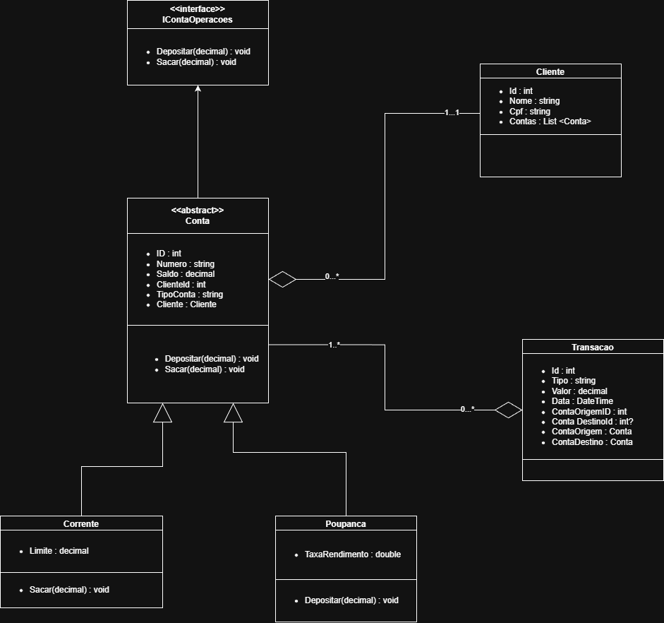

# 💳 UVVFintech - Grupo 3

Projeto desenvolvido para a disciplina **Programação Orientada a Objetos II** (Professor Vinícius Rosalen da Silva - UVV), em 2025/2.

## 🧠 Objetivo
Criar um **sistema bancário de balcão em WPF (C#)** aplicando o padrão **MVC**, princípios **SOLID** e persistência de dados com **Entity Framework Core**.

## ✨ Funcionalidades
- Login e menu principal
- Cadastro de clientes
- Contas corrente e poupança, com depósito, saque e rendimento da poupança
- Transferência entre contas
- Extrato por período

## 🏗️ Estrutura
- **Models/** → Cliente, Transacao e Conta, com ContaCorrente e Poupanca como subclasses e a interface IContaOperacoes
- **Controllers/** → ClienteController e ContaController, com a lógica de negócio
- **Views/** → 9 telas WPF (XAML)
- **DB/** → AppDbContext (Entity Framework Core) e SQLPuro (consultas em SQL direto)
- **DiagramasUML/** → diagrama de classes e diagrama de casos de uso



## ⚙️ Tecnologias
- C# / .NET 9.0
- WPF
- Entity Framework Core
- SQL Server (LocalDB)
- Visual Studio

## 🚀 Como rodar
1. Clone o repositório:

   ```bash
   git clone https://github.com/KrigerThomas/uvvfintech-grupo3.git
   ```

2. Abra o arquivo UVVFintech_Grupo3.sln no Visual Studio.
3. No Package Manager Console, execute:

   ```powershell
   Update-Database
   ```

4. Pressione Ctrl + F5 para executar o sistema.

## 👥 Equipe
- Thomás Kriger
- Cícero Calil
- Cauã Caetano

## 📽️ Vídeo de apresentação

Vídeo usado como parte da entrega do trabalho: https://youtu.be/DQpRqT9d1d8

## 📄 Licença

Este projeto está sob a licença MIT. Veja o arquivo LICENSE para mais informações.
